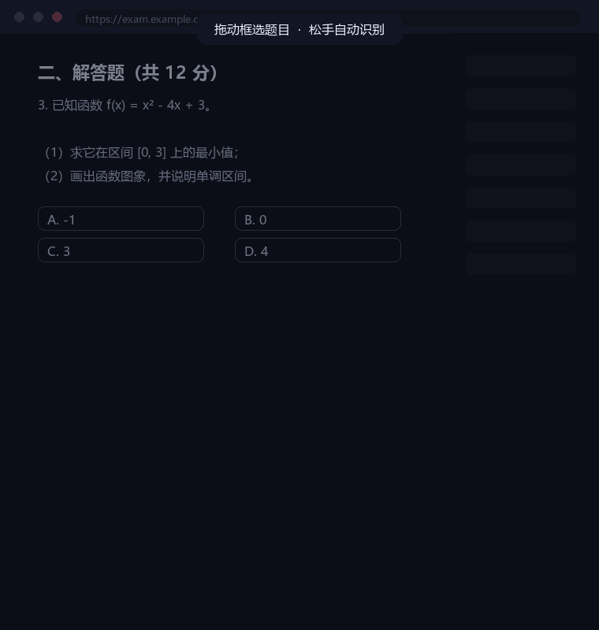

# dsh-quick-ask

给 [DeepSeek Harness](https://github.com/deepseek-ai)（DSH）用的**截图识题 / 翻译 / 讲解**小工具。Windows 桌面悬浮窗，按一个键框选题目，自动 OCR，直接把答案打在小窗里。

```
Ctrl+Alt+A   截图识题（框选 → 识别 → 翻译 / 讲解 / 问答）
Ctrl+Alt+T   整页翻译（左原文 / 右译文）
Ctrl+Alt+R   通话听写（实验，默认麦克风）
```

## 能做什么

### 1. 截图识题（`Ctrl+Alt+A`）

任何程序上都行：网页、PDF、扫描件、游戏画面、PPT。

- 屏幕压暗，拖一个框圈住题目；**只点一下不拖 = 抓整屏**
- 松开鼠标 → 本地 OCR（中英混排）→ 小窗弹出
- 识别结果**可以直接编辑**，改完再问
- 三个动作按钮：
  - **翻译**：把原文翻成另一种语言（中文↔英文自动判断方向）
  - **讲解**：先给结论，再拆原理、步骤、易错点
  - **问 DSH**：按你输入框里的话问；留空 = 按解题回答
- `Ctrl+Enter` 提交，`Esc` 关闭

### 2. 图形题怎么办

OCR 只认字，认不出图形关系（几何图、坐标系、电路图都不行）。所以小窗里有两个按钮：

- **存图**：把框选的那块存成 PNG，默认落在 `图片\DSH快速问答\`
- **贴图**：把原图放进剪贴板，直接粘到能看图的对话里

文字太少时状态行会提示「可能是图形题」。

### 3. 整页翻译（`Ctrl+Alt+T`）

独立的翻译窗：左边原文、右边译文，两栏都能滚。

- 方向按钮在 **自动 / 中→英 / 英→中** 之间切
- 「复制译文」一键带走
- 「重新框选」直接换一段

### 4. 通话听写（`Ctrl+Alt+R`，实验）

「通话记录」窗：点「开始听写」用默认麦克风做离线听写。

- 左边滚动字幕（带时间戳），遇到疑问句自动去要答案放右边
- 「保存记录」存 `文档\DSH通话记录\时间戳.txt`
- **限制**：现在只听麦克风；要听耳机里的对方，需要系统支持「立体声混音」

### 5. 外观设置（右上角 ⚙）

- **虚幻程度** 50%–100%：越低越透，后面的桌面/壁纸引擎透得越多
- **壁纸**：跟随桌面 / 内置背景 / 从 wallpaper-engine 插件库存里挑
- 配置存 `%LOCALAPPDATA%\dsh-quick-ask\config.json`，**重开窗口生效**

### 6. 其他细节

- 小窗可拖动（按住顶部插画/标题区）
- 窗口圆角、细描边、投影；主题是极简深色
- 文字全部用系统字体（Windows 上落微软雅黑）
- 答案自动去 Markdown 星号、公式自动美化（`x^2`→`x²`、`<=`→`≤`）

## 长什么样




翻译页：


## 它由两部分组成

| 目录 | 是什么 | 怎么装 |
|---|---|---|
| 仓库根 | DSH 插件，提供 `/dsh-quick-ask/ask` 接口，把问题转给当前默认模型 | `dsh plugin add github:slient555/dsh-quick-ask` |
| `overlay/` | Windows 小窗：热键、框选、OCR、翻译页 | `install.ps1` 一键装 |

**为什么必须拆开**：DSH 插件运行在网页端，只能改界面，开不了系统级悬浮窗、也截不了屏。所以插件负责「模型入口」，小窗负责「系统交互」，两者通过本机回环 HTTP 通信（端口自动发现）。

## 安装

1. 装插件：`dsh plugin --profile <profile> add github:slient555/dsh-quick-ask`，或在 DSH 插件页添加 `github:slient555/dsh-quick-ask`。
2. 装小窗：右键 `install.ps1` → 用 PowerShell 运行。

安装脚本会：
- 把 `overlay/` 复制到 `%LOCALAPPDATA%\dsh-quick-ask\app`
- 在桌面和「开始菜单 → 启动」建快捷方式（开机自启，可手动删）
- 自检：Windows OCR 语言包、能否找到 DSH 端口

## 使用

| 键 | 作用 |
|---|---|
| `Ctrl+Alt+A` | 截图识题：框选 → OCR → 翻译 / 讲解 / 问答 |
| `Ctrl+Alt+T` | 翻译页 |
| `Ctrl+Alt+R` | 通话听写（实验） |
| `Ctrl+Enter` | 小窗内直接提问 / 翻译 |
| `Esc` | 关闭当前小窗 |
| 鼠标拖拽 | 在框选遮罩里拖出识别区域（不拖 = 整屏） |

小窗内还有「存图 / 贴图」：图形题 OCR 认不出图形关系，可以把原图存下来或放进剪贴板，交给能看图的对话。

右上角 ⚙ 可以调：

- **虚幻程度** 50%–100%（越低越透，能看到后面的桌面 / 壁纸引擎）
- **壁纸** 跟随桌面 / 内置背景 / 从 wallpaper-engine 插件库存里挑（需要装那个插件）

配置存在 `%LOCALAPPDATA%\dsh-quick-ask\config.json`，重开窗口生效。

## 依赖

- Windows 10/11
- 系统自带 OCR 语言包（简中系统默认有 `zh-Hans-CN`）
- DSH 正在运行，且 `` 已安装并启用
- 可选：`@smalltailqwq/dsh-client-ui-skin-maid-atelier`（壁纸库存来源）——没有就退回内置背景

## 开发

```powershell
powershell.exe -NoProfile -ExecutionPolicy Bypass -File overlay\QuickAsk.ps1 -SelfTest    # OCR + DSH 连通
powershell.exe -NoProfile -ExecutionPolicy Bypass -File overlay\QuickAsk.ps1 -UITest      # 界面构建
powershell.exe -NoProfile -ExecutionPolicy Bypass -File overlay\QuickAsk.ps1 -DemoShot out.png
node plugin\test\smoke.mjs                                                                # 插件路由冒烟
node plugin\test\client-load.mjs                                                          # 客户端模块加载
```

> 改 `QuickAsk.ps1` 时注意：PowerShell 5.1 按 ANSI 读无 BOM 的文件，**改完必须保存为 UTF-8 with BOM**，否则中文会整片乱码。

## 已知边界

- OCR 只认印刷体，手写体、艺术字识别不了；图形关系拿不到（用存图/贴图绕过）。
- 动态壁纸没法嵌进窗口，只能靠窗口透明把它透出来。
- 通话听写现在是麦克风收音，要听耳机里的对方需要「立体声混音」这类系统支持。
- 全局热键是轮询实现（80ms 一次），不是系统级注册。

## License

MIT。仓库里不带任何第三方插画素材，默认背景是脚本生成的纯色顶栏。

